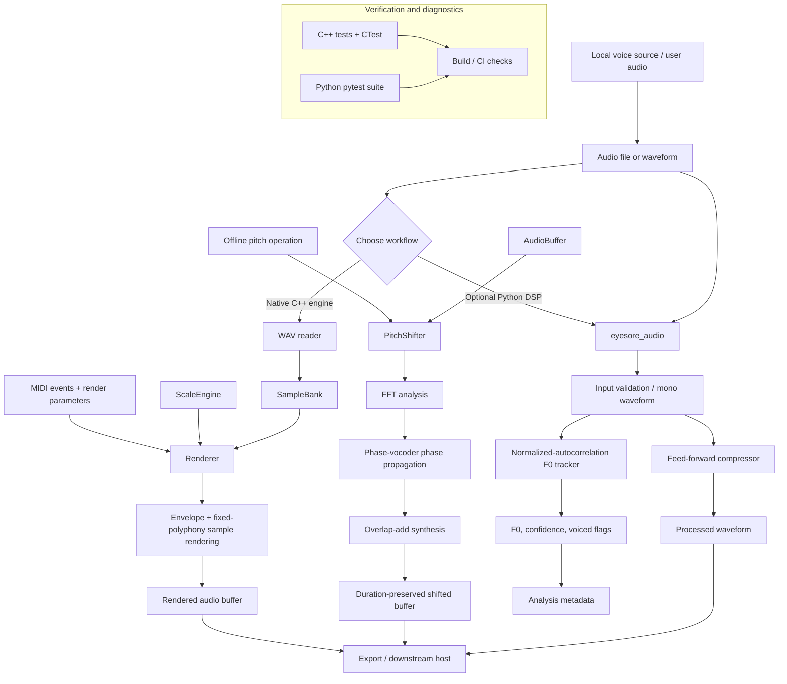

# Eyesore

**A C++17 voice-synthesis and audio-integrity engine with offline vocal analysis and processing.**

Eyesore combines a native audio foundation with optional Python DSP tools for local voice workflows. Audio generation can happen in a local voice engine; Eyesore provides sample management, MIDI-oriented rendering, scale handling, pitch processing, and offline vocal analysis/compression. It does not require a hosted voice service.

## Engineering architecture

The diagram below maps the repository's implemented components and the supported processing routes. It distinguishes the native C++ path from the optional Python post-processing path; they are related tools, not a single real-time processing chain.



### Component responsibilities

| Component | Responsibility | Execution boundary |
|---|---|---|
| WAV reader | Validates RIFF/WAVE chunks and decodes supported PCM/float formats | File/offline |
| SampleBank | Loads, orders, and retains sample buffers; caches pitch variants | Loading and cache mutation require external coordination |
| PositionMap | Stores time/position mappings with synchronized access and serialization | Mutex-backed; not audio-callback safe |
| ScaleEngine | Computes scale pitch ratios and MIDI snapping | Lightweight calculation |
| Envelope | Sample-rate-aware ADSR state for voices | Used by renderer |
| Renderer | Consumes MIDI events and sample buffers to render fixed-polyphony output | Caller supplies output buffer; not a blanket hard-real-time guarantee |
| FFT / PitchShifter | Radix-2 FFT and duration-preserving phase-vocoder pitch shifting | Offline; allocates memory |
| Python F0 tracker | Monophonic normalized-autocorrelation pitch estimate | Offline NumPy DSP |
| Python compressor | Feed-forward dynamics processing with bounded settings and sample-peak ceiling | Offline, allocating; not a true-peak limiter |

## Current implementation

- C++17 core build with CMake and CTest.
- Bounded PositionMap with synchronized access and versioned little-endian serialization.
- Major, natural-minor, pentatonic, chromatic, and custom-mask scale snapping.
- Sample-rate-aware ADSR envelope.
- RIFF/WAVE PCM and IEEE-float reader with chunk-boundary and truncation checks.
- SampleBank with deterministic path ordering and stable buffer addresses during append.
- Fixed-polyphony sample renderer and functional artifact harness.
- Radix-2 FFT and offline, duration-preserving phase-vocoder pitch shifting.
- Optional Python package for monophonic F0 analysis and offline vocal compression.

## Build the C++ engine

```sh
cmake -S . -B build -DCMAKE_BUILD_TYPE=Release
cmake --build build --parallel
ctest --test-dir build --output-on-failure
```

Requires CMake 3.20+ and a C++17 compiler.

## Optional Python vocal DSP

Install the Python dependencies and run the tests:

```sh
python -m pip install "numpy>=1.23" "pytest>=7"
python -m pytest -q
```

The `eyesore_audio` package accepts audio already generated by a local voice engine. It provides normalized-autocorrelation F0 tracking and an offline feed-forward compressor. See [LOCAL-VOCAL-PIPELINE-IMPORT.md](docs/LOCAL-VOCAL-PIPELINE-IMPORT.md).

## Diagnostics and verification

The project has separate native and Python verification layers:

- **CMake configure/build:** checks project generation and C++ compilation.
- **CTest:** runs the registered native tests for version/core setup, PositionMap, ScaleEngine, pitch shifting, and the artifact harness.
- **pytest:** exercises F0 tracking, silence handling, non-finite input rejection, compressor bypass, bounded sample peak, and the combined local-vocal helper.
- **GitHub Actions:** runs the C++ build/CTest and Python DSP test jobs on pull requests and pushes configured by the workflow.

A green test run demonstrates only the covered cases. It does not establish production audio quality, full host integration, race freedom under every usage pattern, or hard-real-time safety. See [DIAGNOSTICS.md](docs/DIAGNOSTICS.md) for the diagnostic matrix, known limits, and recommended investigation order.

## Safety and scope boundaries

- PositionMap uses a mutex to make concurrent access data-race-safe. Its methods may block and are **not real-time safe**; do not call record, reset, deserialize, or serialize from an audio callback.
- SampleBank append preserves existing AudioBuffer addresses through deque storage. Loading and clearing must still be externally serialized against rendering; clear invalidates returned pointers.
- Renderer uses caller-owned buffers and does not perform file I/O. No claim of complete host-level real-time safety, lock freedom, or production audio quality is made.
- Pitch-shifter processing allocates memory and is an offline operation, not suitable for a hard real-time callback.
- The Python F0 tracker and compressor are offline and allocating. The compressor's 0.999 ceiling is sample-peak only, not a true-peak limiter.
- The F0 tracker is monophonic classical DSP, not neural pitch inference. No trained neural-compressor checkpoint is included or claimed.
- The WAV reader supports RIFF/WAVE PCM 16/24/32-bit and IEEE float 32/64-bit mono-downmixed input. RIFX, WAVE64, WAVE_FORMAT_EXTENSIBLE, and compressed formats are rejected.

## Local-first and provenance

Public source excludes private archives, credentials, unpublished disclosure material, personal data, and third-party model/sample assets without verified provenance and license terms. Local voice engines such as XTTS/Coqui may be used upstream to generate audio, but their model weights and runtime are not bundled here.

The project includes discussion of the SPACE concept and its possible patent-related disclosure. Related technical records are subject to provenance and filing-status verification. This notice does not assert that a patent application has been filed, that any application is pending, or that a patent has been granted. See [PROVENANCE.md](docs/PROVENANCE.md).

## License

The repository's MIT license applies to project source files unless a file or directory states otherwise. It does not grant rights to third-party models, samples, datasets, trademarks, or separately licensed materials.
